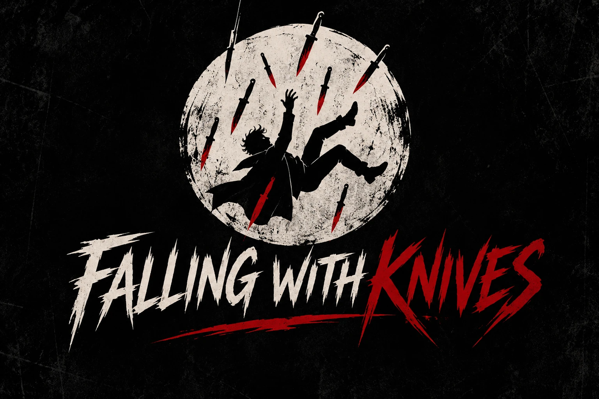

 

### INDEPENDENT DEVELOPMENT STUDIO

**SOFTWARE ENGINEERING · CYBERSECURITY · GAME DEVELOPMENT**

 

*Building things that probably shouldn't exist.*

 

---

## About

**Falling With Knives** is an independent development studio creating software, exploring cybersecurity, and developing interactive experiences.

We combine technical discipline with unconventional thinking. Our focus is on building reliable systems, experimenting with original ideas, and turning ambitious concepts into working technology.

**Question the obvious. Engineer the unexpected.**

---

## What We Do

### 01 — Software Engineering

We develop applications, automation tools, and software solutions with an emphasis on clear architecture, maintainability, and practical functionality.

**Focus:** Applications · Python · Automation · Developer Tools

### 02 — Cybersecurity

We explore security engineering, defensive research, and tools designed to support secure and resilient systems.

**Focus:** Secure Development · Security Testing · System Hardening · Defensive Tooling

### 03 — Game Development

We work on independent game concepts, gameplay systems, and interactive prototypes, combining technical experimentation with creative direction.

**Focus:** Gameplay Programming · Prototyping · Interactive Systems · Indie Games

---

## Our Work

Our public portfolio is currently being established.

This GitHub organization of repositories will become the central home for our software projects, security tools, game prototypes, and technical documentation.

As projects become available, they will be presented with clear descriptions, development status, setup instructions, and relevant technical details.

**Explore our repositories:** [Falling With Knives on GitHub](https://github.com/fallingwithknives?tab=repositories)

---

## How We Build

Our development approach is guided by four principles:

- **Engineering discipline.** Build software that is understandable, maintainable, and fit for purpose.
- **Security awareness.** Consider security, privacy, and reliability throughout development.
- **Creative independence.** Challenge conventions and explore unconventional technical ideas.
- **Continuous improvement.** Test, document, refine, and learn from every iteration.

---

## Connect

Follow the development of Falling With Knives, explore our projects, and stay informed about future releases.

 

[**GitHub**](https://github.com/fallingwithknives) ·
[**YouTube**](https://www.youtube.com/@fallingwithknives) ·
[**Instagram**](https://www.instagram.com/fallingwithknives/)

  

**FALLING WITH KNIVES**

*Software. Security. Games.*

© 2026 Falling With Knives

